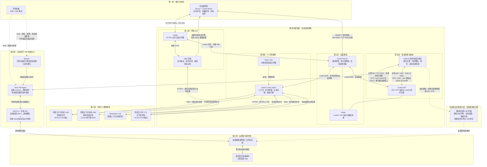

# Persona Voice

基于自建 LiveKit 的中文实时语音助手，支持浏览器实时对话与安卓 SIM 电话 AI 对话。

稳定基线：**v1.0.0（2026-11-03）**。已在当前腾讯云服务器与 K60 Pro 上完成手机双向音频、连续问答和 AI 语音回复测试，用户确认体验良好。这是已验证环境的稳定基线，不代表所有安卓机型、网络或高并发场景均已验证。

网页版：https://phone.hehaizhao.site/ （需要访问码）

咨询工作台：https://phone.hehaizhao.site/consult （独立管理员密码）。支持网页实时语音和真实 DeepSeek 文字调研：千问流式 ASR → DeepSeek → 千问 TTS，双方转录同步展示、插话打断、结束语播放后归档、报告和转录双 Markdown 导出。千问共用 Key 在「语音配置」中填写。「电话线路」支持睡眠模板、白名单号码、拨打前检查、拨号后自动进入对话及按会话挂断；SIM 2 固定，最长约 180 秒，管理端口保持本机私有。会话页面提供分阶段诊断与事件时间线。部署、日志及排查说明见 [咨询工作台手册](docs/CONSULTATION_WORKSPACE.md)。

## 电话时延优化报告

[GitHub Issues 与五阶段 Markdown 报告](docs/performance/README.md)：基线、识别收尾、TTS 流式、提前生成、简短发言。每次测试结束在对应 Issue 追加结果，保留优化前后逐段耗时与占比、异常原因及结论；未接通不计为有效样本。换手机或 SIM 后重新建立基线，报告随代码提交 GitHub。

## 当前架构

下图展示当前部署、音频流向与调试通道；商业 SIP 中继为未来方案，尚未接入。USB / ADB 只用于配置和排障，不承载实际通话音频。



- 实时模式：持续输入麦克风音频、显示识别结果，自动判断说话结束并回复，支持插话打断。
- 录音输入模式：点击录音、停止后识别成文字，确认后发送；录音时关闭实时通话麦克风，避免重复输入。
- 电话模式：实体 SIM 拨号，接听后进入独立 LiveKit 房间并启动 AI；不需要 LiveKit Cloud 或运营商 SIP 中继。
- 测试辅助：入房前音量检查、扬声器测试、音频播放解锁，以及独立 TTS、实时对话和 SIP 测试脚本。

旧模拟外呼页面、`/api/conversation`、Base64 音频回复和临时音频 URL 已不再使用。当前语音链路不依赖 ElevenLabs 或阶跃星辰。

## 技术栈

| 层 | 当前实现 |
| --- | --- |
| Web | Next.js 15.5.28、React、LiveKit React Components |
| 实时媒体 | 自建 LiveKit Server 1.13.11 |
| Agent | Python、LiveKit Agents 1.8.10、Silero VAD |
| ASR | `qwen-audio-3.1-asr-flash-streaming`，16 kHz PCM |
| 录音识别 / ASR 回退 | `qwen-audio-3.1-asr-flash`，HTTP |
| LLM | DeepSeek，默认 `deepseek-chat` |
| TTS | `qwen-audio-3.1-tts-flash`，音色 `longanhuan_v3.1`，24 kHz PCM |
| 电话桥 | Asterisk 22.5.2、LiveKit SIP 1.22.0 |
| 安卓网关 | [Voice SIP Agent](https://github.com/sparkcyf/android-voice-sip-agent) 0.4.0、Shizuku |

ASR 持续使用 WebSocket；LLM 流式生成文本，TTS 按句提交、逐块播放。电话侧使用 G.711，由桥接服务完成媒体转换。

## 本地启动

需要 Node.js 22.22+、Python（当前服务器为 3.14；CI 语法检查使用 3.12）、FFmpeg，以及可连接的 LiveKit 服务和模型权限。本地若与生产连接同一 LiveKit，建议设置不同的 `LIVEKIT_AGENT_NAME`，避免开发 Agent 接收生产任务。

在仓库根目录创建配置：

```bash
cp .env.example .env
# 编辑 .env，填入实际配置；不要提交密钥。
```

启动 Agent：

```bash
python3.12 -m venv .venv-agent
source .venv-agent/bin/activate
pip install -r services/agent/requirements.txt
python -m livekit.agents download-files
python services/agent/agent.py dev
```

另开终端，在仓库根目录启动 Web。Next.js 不会自动读取上一级目录的 `.env`，使用 Node 显式加载：

```bash
cd web
npm ci
node --env-file=../.env node_modules/next/dist/bin/next dev --turbopack
```

打开 `http://127.0.0.1:3000`，输入访问码并允许麦克风权限。远程访问麦克风必须使用 HTTPS，不能直接使用普通 HTTP 公网 IP。

## 环境配置

所有密钥只在服务端使用，不要添加 `NEXT_PUBLIC_` 前缀。浏览器通过访问码换取限定房间的短期令牌。

| 配置 | 用途 |
| --- | --- |
| `LIVEKIT_URL` | 当前生产为 `wss://phone.hehaizhao.site/livekit`；也支持其他自建实例或 Cloud |
| `LIVEKIT_API_KEY` / `LIVEKIT_API_SECRET` | LiveKit 服务端凭据，须与实例一致 |
| `LIVEKIT_AGENT_NAME` | Web、SIP dispatch、Agent 必须匹配；默认 `persona-voice-agent` |
| `VOICE_ACCESS_CODE` | 网页访问码；生产必须设置长随机值 |
| `DASHSCOPE_API_KEY` / `DASHSCOPE_WORKSPACE` | 百炼北京地域密钥与业务空间，须匹配且有模型权限 |
| `QWEN_ASR_URL` / `QWEN_ASR_MODEL` | 录音识别与 batch 回退的 HTTP 地址、模型 |
| `ASR_MODE` | 默认 `streaming`；`batch` 使用 VAD 分句 HTTP 回退 |
| `QWEN_STREAMING_ASR_MODEL` | 流式 ASR 模型 |
| `QWEN_TTS_MODEL` / `QWEN_TTS_VOICE` | TTS 模型与音色 |
| `DASHSCOPE_TTS_API_KEY` / `DASHSCOPE_TTS_WORKSPACE` | 可选 TTS 独立凭据；留空沿用共享配置 |
| `DEEPSEEK_API_KEY` / `LLM_MODEL` | 对话模型凭据及模型名 |
| `LIVEKIT_AGENT_IDLE_PROCESSES` | 当前 4 GB 服务器设为 `1` |

`/api/transcribe` 始终使用录音识别模型，不受 `ASR_MODE` 影响；FFmpeg 将录音转为 16 kHz 单声道 WAV。模型 API 与 SIM 通话可能产生费用。

## 腾讯云部署与 GitHub 自动更新

生产项目路径：`/home/ubuntu/Project/persona-voice`。

每次 push 到 `main` 触发 `.github/workflows/deploy.yml`：

```text
Python 语法检查 → 前端依赖审计 / lint / build
  → SSH / rsync 同步 → 重启 Web 和 Agent → HTTPS 检查
```

仓库 Actions Secrets：`DEPLOY_HOST`、`DEPLOY_USER`、`DEPLOY_SSH_KEY`、`DEPLOY_KNOWN_HOSTS`。部署账号须有部署脚本所需的 sudo 权限。

| 服务 | 职责 |
| --- | --- |
| `persona-voice-web` | Web/API，127.0.0.1:5050 |
| `persona-voice-agent` | ASR、LLM、TTS 对话进程 |
| `persona-livekit` | 自建实时媒体服务 |
| `persona-livekit-sip` | Asterisk 与 LiveKit 之间的 SIP 桥 |
| `asterisk` | 安卓网关注册、受限拨号及音频路由 |
| `redis-server` | LiveKit/SIP 共享状态 |
| `caddy` | HTTPS 与 WebSocket 反向代理 |

自动部署保留 `.env`、虚拟环境、`BigApple输出/` 等目录，不改动 `/etc/persona-livekit`、`/etc/asterisk` 或 Redis 数据。首次基础设施安装及 SIP 配置变更必须显式执行，普通 push 不会自动安装。部署会重启 Agent，应避开正在进行的电话。

详细步骤见 [自建 LiveKit](ops/SELF_HOSTED.md) 和 [SIM AI 桥接](ops/SIM_AI.md)。脚本面向当前固定服务器布局，不是任意服务器的一键安装器。

### 网络边界

| 端口 | 用途 / 范围 |
| --- | --- |
| TCP 443 | 公网 HTTPS / LiveKit WebSocket |
| TCP 5052、UDP 5053 | 公网 LiveKit 媒体 |
| TCP 5054、UDP 10000–10019 | 安卓 SIP 网关信令 / RTP |
| 7880 | LiveKit 内部 API；不开放公网，由 Caddy 代理 |
| 127.0.0.1:5060 / 5062 | SIP 桥 / Asterisk 本机信令 |
| UDP 20000–20099 | SIP 桥本机 RTP，不需新增公网放行 |
| 127.0.0.1:6379 | Redis，仅本机 |

当前未部署 TURN/TLS；严格限制媒体端口的网络仍可能连接失败。

## 手机 SIM 测试

已提供[私有网页电话控制台与网关恢复工具](docs/PHONE_GATEWAY_OPERATIONS.md)：通过 SSH 隧道访问，支持受限拨号、挂断和状态查看。脱离 USB、手机重启与长期待机的验收状态也在该文档中逐项记录。

验证设备：K60 Pro、Android 16、Shizuku、Voice SIP Agent；当前有效卡为 SIM 2（逻辑槽位 `1`）。安卓 SDK 本身不保证能访问蜂窝通话音频；换手机、系统或 SIM 后都要重新验证。USB 用于调试与配置，通话音频通过网络传输。

1. 确认网关就绪、Shizuku 已连接、SIM 槽位正确，接听人同意测试。
2. 检查 `pjsip show contacts` 注册状态，确认没有其他通话。
3. 先测试回声，确认接听端听到提示音和自己的声音。
4. 按 [SIM AI 操作说明](ops/SIM_AI.md) 使用受限拨号命令，测试问候、连续问答和插话。

AI 拨号只允许已配置的测试接听号码，最长约 180 秒；来电接管关闭。实体 SIM 决定实际主叫号码，不能用 SIP Caller ID 伪造。当前没有面向公众的任意号码拨号 API 或批量外呼功能。

## 验证与排障

- [调试复盘](docs/DEBUGGING_RETROSPECTIVE.md)：本次问题、已确认原因、修复证据及验证边界。
- [故障排查手册](docs/TROUBLESHOOTING.md)：按现象分层检查、预期结果、安全边界与故障记录模板。

以下检查不会发起电话：

```bash
sudo systemctl is-active persona-livekit persona-livekit-sip persona-voice-agent persona-voice-web asterisk redis-server
sudo journalctl -u persona-voice-agent -n 100 --no-pager
sudo journalctl -u persona-livekit-sip -n 100 --no-pager
sudo asterisk -rx 'pjsip show contacts'
sudo asterisk -rx 'pjsip show channelstats'
sudo asterisk -rx 'core show channels concise'
curl --fail https://phone.hehaizhao.site/livekit/
curl --fail https://phone.hehaizhao.site/api/token
```

`GET /api/token` 是健康检查，不代表真实麦克风、模型或手机音频已经通过测试。

以下测试调用模型并消耗额度，但不拨手机：

```bash
.venv-agent/bin/python scripts/check-tts.py
.venv-agent/bin/python scripts/smoke-realtime.py
```

前者独立验证 TTS，输出 `BigApple输出/tts-check.wav`；后者当前固定访问上述生产站点，验证两轮合成语音输入、识别、回复音频和打断。服务器 SIP 测试与观察脚本见 [SIM AI 操作说明](ops/SIM_AI.md)。观察脚本仅用于授权测试，可能输出对话文本，不保存原始通话录音。

| 现象 | 优先检查 |
| --- | --- |
| `/api/token` 401 | 访问码和服务器环境变量；不是 ASR 错误 |
| 百炼 400 | Key 与 workspace 是否匹配、模型及请求参数 |
| 一直聆听 | 麦克风音量、轨道发布、Agent 加入状态、ASR 日志 |
| 有文字但无声 | 独立 TTS 测试、浏览器音频解锁、音量及输出设备 |
| 电话接通无声 | 两侧 RTP 包数、UDP 防火墙、网关音频后端；注册成功不等于音频成功 |
| 超时 / closed engine | 自建 URL、信令与媒体端口、连接生命周期；不要切回旧 Cloud 地址 |

## 稳定版本边界与安全

- 浏览器实时链路、手机回声、SIM AI 两轮对话均已验证，用户确认当前体验良好；长时通话、并发、异常网络恢复和其他安卓设备尚未完成系统性验证。
- DeepSeek 未接入实时搜索。最新产品、新闻和价格不可视为实时事实；提示词要求说明限制，但不能保证消除幻觉。
- 不提交 `.env`、LiveKit 凭据或 SIP 密码。曾在聊天或日志中暴露的真实密钥应轮换；不要公开含密钥的日志。
- 访问码不是完整的多租户鉴权与计费系统。对外开放更多用户前应补充账号权限、费用限制和审计。
- 仅对授权号码测试，遵守运营商条款及当地隐私、录音和通信法规。
- `v1.0.0` 标记源码基线，不备份服务器 `.env`、Redis 或系统配置；回滚源码不能替代基础设施恢复。

## 目录

```text
web/                  浏览器实时语音界面与 API
services/agent/       对话 Agent、千问 ASR/TTS 适配
scripts/              部署、配置及验证脚本
ops/                  systemd、Caddy、LiveKit、Asterisk 配置与运维文档
.github/workflows/    main 分支自动测试和部署
BigApple输出/         本地测试产物（Git 忽略）
```
